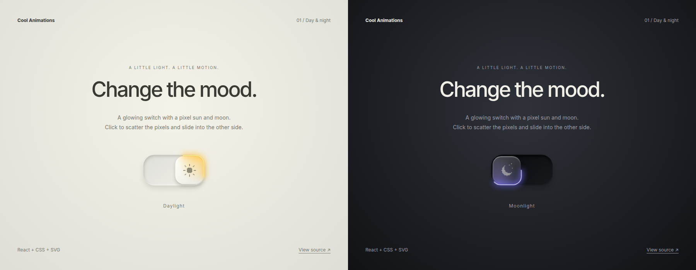

# Cool Animations

Reusable React animations. The first module is **DayNightSwitch**, a day/night toggle with a sliding square thumb, an orbiting gold or violet glow, and a pixel sun/moon scatter animation.



## Run the demo

Requires Node.js 20 or newer.

```sh
npm install
npm run dev
```

Open the local URL printed by Vite. The demo controls its own theme and does not require Pocket Expenses, Tailwind, an account, or a backend.

## Use the module

Copy `src/DayNightSwitch.tsx` and `src/DayNightSwitch.css` together into your React project. The component imports its CSS directly.

```tsx
import { useState } from 'react'
import DayNightSwitch from './components/DayNightSwitch'

export default function Appearance() {
  const [dark, setDark] = useState(false)

  return (
    <DayNightSwitch
      dark={dark}
      onToggle={() => setDark(value => !value)}
    />
  )
}
```

The switch is controlled. Apply `dark` to your app's theme or theme provider, and persist it if needed. It does not change document classes or save preferences itself.

| Prop | Type | Purpose |
| --- | --- | --- |
| `dark` | `boolean` | Current mode. Moon on the left when true, sun on the right when false. |
| `onToggle` | `() => void` | Called when the switch is activated. Update your theme here. |
| `className` | `string` | Optional class for layout or styling. |

Set `--day-night-focus` on the switch or an ancestor to customize its focus outline. The base control is 90 × 48 CSS pixels. Keyboard Space and Enter activate the button, `role="switch"` and `aria-checked` expose its state, and reduced-motion preferences disable movement.

## Build

```sh
npm run build       # ES module, CSS, and TypeScript declarations in dist/
npm run build:demo  # Standalone demo in dist-demo/
npm run preview    # Serve the built demo locally
```

For a local package build, import `DayNightSwitch` from the package and load `@tareqarnaout/cool-animations/style.css` once. This repository is not published to npm.

## Design reference

Inspired by the day/night switch in Zsolt Kacso's “Clicking this is almost more fun than building it” video. This repository contains an independent React/CSS/SVG implementation originally created for Pocket Expenses. The reference video is not included.
